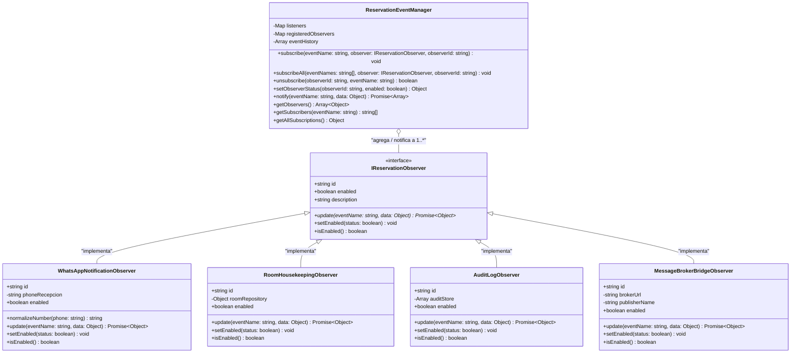
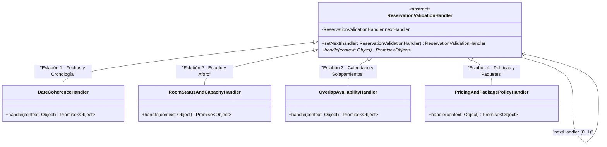

# Documentación de Patrones de Software - Tercer Corte

## Sistema de Reservación de Hoteles
**Asignatura:** Patrones de Software  
**Patrones de Comportamiento Implementados:** 
1. **Chain of Responsibility** (Cadena de Responsabilidad para Validación de Reservas)
2. **Observer** (Publicación y Suscripción Desacoplada de Eventos de Ciclo de Vida)
3. **Integración Completa con Segundo Corte:** Conexión con `Composite` y `ReservationBuilder`.

---

## 1. Diagrama de Clases 1: Patrón Observer (Aislado)

El patrón **Observer** desacopla el ciclo de vida de la reserva de los efectos secundarios (notificaciones WhatsApp al huésped, cambios de estado operativo en camarería/Housekeeping, bitácora de auditoría inmutable y retransmisión asíncrona hacia el Message Broker distribuido).

Permite **suscripción y desuscripción en caliente (Hot-Swap)** cumpliendo estrictamente con el principio **Open/Closed (OCP)** y **Single Responsibility (SRP)**.



### Eventos Soportados por el Subject:
* `RESERVA_CREADA` (o `RESERVA`): Genera confirmación con enlace universal a WhatsApp (`https://wa.me/...`), programa dotación a camarería, registra auditoría con checksum SHA-256 y despacha al broker.
* `CHECK_IN_REALIZADO` (o `CHECK_IN`): Envía credenciales WiFi y bienvenida, marca habitación como `OCUPADA`.
* `CHECK_OUT_REALIZADO` (o `CHECK_OUT`): Envía agradecimiento, marca habitación como `LIMPIEZA PRIORITARIA` para Housekeeping.

---

## 2. Diagrama de Clases 2: Patrón Chain of Responsibility (Aislado)

El patrón **Chain of Responsibility** organiza la lógica previa de verificación en eslabones desacoplados encadenados mediante el método `setNext()`. Cada eslabón evalúa una única regla de negocio y puede **interrumpir el flujo (Short-Circuit)** si la solicitud es inválida, protegiendo la base de datos y evitando notificaciones espurias.



### Eslabones de la Cadena y Responsabilidades:
1. **`DateCoherenceHandler` (Eslabón 1):** Valida formato ISO, que la fecha de inicio sea estrictamente menor a la fecha fin y que no pertenezca al pasado.
2. **`RoomStatusAndCapacityHandler` (Eslabón 2):** Valida que la habitación exista, que su estado no sea `MANTENIMIENTO` ni `BLOQUEADA`, y que el total de huéspedes no supere la capacidad máxima permitida.
3. **`OverlapAvailabilityHandler` (Eslabón 3):** Verifica la disponibilidad en el calendario comprobando que no existan reservas previas activas solapadas en el intervalo `[fechaInicio, fechaFin)`.
4. **`PricingAndPackagePolicyHandler` (Eslabón 4):** Valida la vigencia de paquetes turísticos, estadías mínimas requeridas y reglas comerciales.

---

## 3. Diagrama de Clases 3: Arquitectura Integrada del Sistema

Muestra cómo la capa de servicio (`BookingService` / `ReservationService` / `PatronesController`) coordina la arquitectura completa conectando:
$$\text{Chain of Responsibility} \longrightarrow \text{Composite} \longrightarrow \text{ReservationBuilder} \longrightarrow \text{Observer}$$

```mermaid
classDiagram
    direction TB

    class BookingService {
        +crearReserva(datosReserva: Object) Promise~Object~
        +ejecutarCheckIn(reservaId: string) Promise~Object~
        +ejecutarCheckOut(reservaId: string) Promise~Object~
        +simular(modo: string, accion: string, payload: Object) Promise~Object~
    }

    %% 1. CHAIN OF RESPONSIBILITY
    class ReservationValidationHandler {
        <<abstract>>
        +setNext(handler) ReservationValidationHandler
        +handle(context: Object) Promise~Object~
    }
    class DateCoherenceHandler {
        +handle(context: Object) Promise~Object~
    }
    class RoomStatusAndCapacityHandler {
        +handle(context: Object) Promise~Object~
    }
    class OverlapAvailabilityHandler {
        +handle(context: Object) Promise~Object~
    }
    class PricingAndPackagePolicyHandler {
        +handle(context: Object) Promise~Object~
    }

    %% 2. COMPOSITE
    class ComponenteCotizacion {
        <<abstract>>
        +calcularPrecio()* number
        +obtenerDesglose()* Object
    }
    class HospedajeItem {
        -number precioNoche
        -number noches
        +calcularPrecio() number
    }
    class ServicioSimple {
        -number precio
        -number cantidad
        +calcularPrecio() number
    }
    class PaqueteCompuesto {
        -number descuentoPorcentaje
        -Array items
        +agregar(item: ComponenteCotizacion) void
        +calcularPrecio() number
    }
    class CotizacionReserva {
        -Array items
        -number impuestoPorcentaje
        +agregar(item: ComponenteCotizacion) CotizacionReserva
        +calcularPrecio() number
        +obtenerDesglose() Object
    }

    %% 3. BUILDER
    class ReservationBuilder {
        -string clienteId
        -string habitacionId
        -Date fechaInicio
        -Date fechaFin
        -CotizacionReserva cotizacion
        +conCliente(clienteId) ReservationBuilder
        +conHabitacion(habitacionId) ReservationBuilder
        +conFechas(inicio, fin) ReservationBuilder
        +conCotizacion(cotizacion) ReservationBuilder
        +conEstado(estado) ReservationBuilder
        +build() Reservation
    }

    class Reservation {
        +string id
        +string codigo
        +number total
        +string estado
    }

    %% 4. OBSERVER
    class ReservationEventManager {
        +subscribe(evento, observer) void
        +unsubscribe(observerId) boolean
        +notify(evento, payload) Promise~Array~
    }
    class IReservationObserver {
        <<interface>>
        +update(evento, payload)* Promise
    }
    class WhatsAppNotificationObserver {
        +update(evento, payload) Promise
    }
    class RoomHousekeepingObserver {
        +update(evento, payload) Promise
    }
    class AuditLogObserver {
        +update(evento, payload) Promise
    }
    class MessageBrokerBridgeObserver {
        +update(evento, payload) Promise
    }

    %% RELACIONES
    BookingService --> ReservationValidationHandler : "1. Valida con Cadena"
    ReservationValidationHandler <|-- DateCoherenceHandler
    ReservationValidationHandler <|-- RoomStatusAndCapacityHandler
    ReservationValidationHandler <|-- OverlapAvailabilityHandler
    ReservationValidationHandler <|-- PricingAndPackagePolicyHandler

    BookingService --> CotizacionReserva : "2. Tarifica con Composite"
    ComponenteCotizacion <|-- HospedajeItem
    ComponenteCotizacion <|-- ServicioSimple
    ComponenteCotizacion <|-- PaqueteCompuesto
    ComponenteCotizacion <|-- CotizacionReserva
    CotizacionReserva o-- ComponenteCotizacion : "compone"

    BookingService --> ReservationBuilder : "3. Ensambla paso a paso"
    ReservationBuilder --> CotizacionReserva : "consume total"
    ReservationBuilder ..> Reservation : "instancia final"

    BookingService --> ReservationEventManager : "4. Emite evento de dominio"
    ReservationEventManager o-- IReservationObserver : "despacha"
    IReservationObserver <|-- WhatsAppNotificationObserver
    IReservationObserver <|-- RoomHousekeepingObserver
    IReservationObserver <|-- AuditLogObserver
    IReservationObserver <|-- MessageBrokerBridgeObserver
```



---

## 4. Tabla Comparativa: Con Patrones vs. Sin Patrones

| Criterio Arquitectónico | Sin Patrones (Línea Base Monolítica) | Con Patrones (Chain + Observer + Composite + Builder) |
|---|---|---|
| **Grado de Acoplamiento** | **Alto (Tightly Coupled):** Validaciones inline y notificaciones invocadas directamente dentro del método principal. | **Bajo (Loose Coupling):** Desacoplamiento total mediante interfaces, eslabones de cadena y despacho de eventos. |
| **Open/Closed Principle (OCP)** | **Viola OCP:** Agregar una nueva regla de validación o un nuevo canal (ej. Telegram o SMS) obliga a modificar la función central. | **Cumple OCP:** Se añaden nuevos `Handlers` u `Observers` instanciando la clase correspondiente sin tocar el código base. |
| **Single Responsibility (SRP)** | **Viola SRP:** Un único método "Dios" valida fechas, calcula precios, persiste registros, genera textos y despacha mensajes. | **Cumple SRP:** Cada clase posee una responsabilidad única: `DateCoherenceHandler` sólo valida fechas, `WhatsAppObserver` sólo genera links. |
| **Suscripción Dinámica en Vivo** | **Imposible:** El flujo de ejecución es estático y cableado en duro. | **Soportada:** Posibilidad de suscribir o desuscribir observadores en tiempo de ejecución (Hot-Swap) vía endpoint REST. |
| **Control de Fallos y Short-Circuit** | **Frágil:** Exige múltiples niveles de `if/else` anidados propensos a regresiones. | **Robusto:** La cadena corta la propagación de forma inmediata (`context.trace`) protegiendo al Subject de notificaciones erróneas. |
| **Testeabilidad Unitaria** | **Muy Compleja:** Requiere instanciar todo el entorno monolítico con mocks masivos. | **Alta:** Cada eslabón y observador se prueba de forma aislada e independiente con pruebas unitarias limpias. |

---

## 5. Instrucciones de Demostración

### A. Demostración Interactiva en Frontend (Next.js Dashboard)
1. Iniciar la aplicación web en `http://localhost:3000`.
2. Iniciar sesión como personal de recepción o administrador (`admin@hotel.com`).
3. Navegar en el menú lateral a **"Laboratorio de Patrones"** (`/dashboard/patrones`).
4. **Pruebas en vivo posibles:**
   * **Switches en Caliente:** Encender/apagar el switch de `WhatsAppNotificationObserver` o `MessageBrokerBridgeObserver` y observar cómo reacciona el backend.
   * **Simulador Comparativo:** Alternar entre *"Con Patrones"* y *"Sin Patrones"* para comparar la trazabilidad.
   * **Short-Circuit por Aforo:** Seleccionar el preset de 8 huéspedes en habitación de 4 para verificar cómo la cadena detiene el flujo en el Eslabón 2.
   * **Enlace de WhatsApp Directo:** Hacer clic en *"Abrir Chat WhatsApp"* para comprobar la URL generada (`https://wa.me/57...`).

### B. Demostración en Terminal (CLI)
Para ejecutar la comparativa automatizada con salidas estructuradas por consola, corre el comando:

```bash
# Desde la raíz del proyecto:
npm run demo:patrones

# O directamente desde el microservicio:
cd services/booking-service
npm run demo:patrones
```

El script ejecutará automáticamente 4 escenarios:
1. **Línea Base Procedimental:** Ejecución con bloque monolítico if/else inline.
2. **Con Patrones (Chain + Observer):** Trazabilidad completa de los 4 eslabones y 4 observadores con enlace de WhatsApp.
3. **Hot-Unsubscribe:** Desuscripción en caliente de WhatsApp y Broker demostrando reactividad selectiva.
4. **Short-Circuit:** Intento de reserva con aforo excedido, demostrando la interrupción de la cadena antes de notificar.
