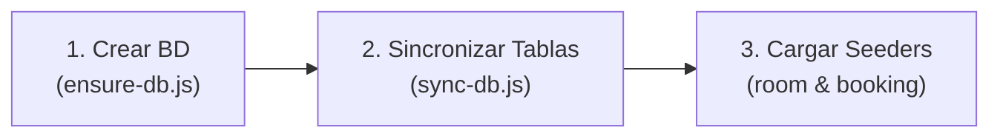

# 🏨 Sistema de Reservación de Hoteles (Patrones de Software)

Aplicación web integral de gestión hotelera y reservaciones turísticas desarrollada para la asignatura de **Patrones de Software**. Cuenta con dos arquitecturas comparativas: una **línea base monolítica procedimental (sin patrones)** y una **arquitectura refactorizada basada en microservicios y patrones de diseño (Factory Method, Builder, Composite y Pub/Sub Broker)**.

---

## 🏛️ Comparativa de Arquitecturas

### 1️⃣ Versión con Patrones (Microservicios + Next.js)
```
sistema-reservacion-hoteles/
├── frontend/                 # 🎨 Next.js 14 + React + TS (Puerto 3000)
└── services/
    ├── room-service/         # 🏨 Catálogo (Habitaciones, Tags, Fotos) [Factory Method] (Puerto 4001)
    ├── booking-service/      # 📅 Reservas (Usuarios, Auth, Paquetes) [Builder + Composite] (Puerto 4002)
    └── message-broker/       # 📨 Broker central asíncrono [Pub/Sub] (Puerto 4003)
```

**Patrones implementados en Microservicios:**
* **Factory Method** (`room-service`): Familia de creadores concretos (`CreadorSencilla`, `CreadorDoble`, `CreadorSuite`) para instanciar tipos de habitaciones.
* **Builder** (`booking-service`): Construcción y validación paso a paso de reservaciones complejas (`ReservationBuilder`).
* **Composite** (`booking-service`): Jerarquía polimórfica para tarificación y cotización de estadías, servicios individuales y paquetes compuestos (`ComponenteCotizacion`, `HospedajeItem`, `ServicioSimple`, `PaqueteCompuesto`, `CotizacionReserva`).
* **Publish / Subscribe** (`message-broker`): Bus de eventos desacoplado para notificar `RESERVA_CREADA`.
* **API Gateway / Proxy** (`frontend`): Rewrites transparentes en Next.js.

---

### 2️⃣ Versión Línea Base Sin Patrones (Monolito)
```
sistema-reservacion-hoteles/
├── frontend-monolito/        # 🎨 Next.js 14 conectado al monolito (Puerto 3001)
└── backend/                  # 🏛️ Backend Monolítico Express (Puerto 4000 /api/v1)
```
* **Cálculo procedimental**: Utiliza bucles `for` e `if/else` manuales para acumular precios de servicios y paquetes sin abstracciones.

---

## 📋 Requisitos previos

Antes de empezar, asegúrate de tener instalado:

| Herramienta | Versión recomendada | Notas |
|-------------|---------------------|-------|
| Node.js     | **22.x** o superior | Requerido por la sintaxis nativa `--env-file` |
| npm         | **10.x** o superior | Incluido junto con Node.js |
| MySQL       | **8.0** o superior  | Servicio MySQL corriendo localmente en el puerto 3306 |
| Git         | Cualquier versión reciente | Para clonar el repositorio |

---

## 🚀 1. Clonar el repositorio

```bash
git clone https://github.com/PedroSuarez1402/sistema-reservacion-hoteles.git
cd sistema-reservacion-hoteles
```

## ⚙️ 2. Instalar dependencias

Para la arquitectura recomendada (Microservicios + Frontend Next.js), instala las dependencias de cada módulo:

```bash
# 1. Frontend Web (Next.js)
cd frontend
npm install
cd ..

# 2. Microservicio de Habitaciones y Catálogo (room-service)
cd services/room-service
npm install
cd ../..

# 3. Microservicio de Reservas y Usuarios (booking-service)
cd services/booking-service
npm install
cd ../..

# 4. Message Broker Pub/Sub (message-broker)
cd services/message-broker
npm install
cd ../..
```

---

## 🔐 3. Configurar variables de entorno (.env)

Cada servicio cuenta con su archivo de plantilla `.env.example`. Copia cada uno a un archivo `.env` en su respectiva carpeta:

### 3.1 Copiar plantillas

```bash
# En Linux / macOS / Bash:
cp services/room-service/.env.example services/room-service/.env
cp services/booking-service/.env.example services/booking-service/.env
cp services/message-broker/.env.example services/message-broker/.env

# En Windows (PowerShell):
# copy services/room-service/.env.example services/room-service/.env
# copy services/booking-service/.env.example services/booking-service/.env
# copy services/message-broker/.env.example services/message-broker/.env
```

### 3.2 Ajustar credenciales en los archivos `.env`

Abre `services/room-service/.env` y `services/booking-service/.env` con tu editor y configura tus credenciales de MySQL:

```env
# MySQL (ambos servicios apuntan a la misma base de datos 'sistema-reservas')
DB_NAME=sistema-reservas
DB_USER=root
DB_PASSWORD=tu_contraseña_mysql
DB_HOST=localhost
DB_PORT=3306
DB_SSL=false

# Clave secreta para tokens JWT (¡DEBE SER IDÉNTICA EN AMBOS SERVICIOS!)
JWT_SECRET=una_clave_secreta_compartida_super_segura
JWT_EXPIRES_IN=24h
BCRYPT_SALT_ROUNDS=10

# Message Broker central
BROKER_URL=http://localhost:4003
```

> 🔐 **Importante**: `room-service` y `booking-service` **deben compartir el mismo `JWT_SECRET`** para que los tokens emitidos en autenticación sean válidos en ambos microservicios.

---

## 🗄️ 4. Base de datos MySQL (Creación, Sincronización y Seeders)

Para poner en marcha la base de datos desde cero, sigue estos **3 pasos en orden**:



---

### Paso 4.1: Crear la Base de Datos (`ensure-db`)

Crea la base de datos `sistema-reservas` en MySQL si aún no existe. Es un script idempotente (puedes ejecutarlo desde `room-service` o `booking-service`):

```bash
cd services/room-service
npm run db:ensure
# O alternativamente: node --env-file=.env ensure-db.js
cd ../..
```

> ✅ Salida esperada: `✅ Base de datos 'sistema-reservas' creada exitosamente.` o `✅ Base de datos 'sistema-reservas' ya existe.`

---

### Paso 4.2: Sincronizar las Tablas con los Modelos (`sync-db`)

> ⚠️ **¡Paso clave antes de los seeders!**  
> `ensure-db.js` únicamente crea la base de datos vacía, **no crea las tablas**.  
> El script **`sync-db.js`** lee los modelos Sequelize y crea físicamente las tablas y llaves foráneas en MySQL. Debes sincronizar ambos microservicios:

```bash
# 1. Crear tablas del catálogo (habitaciones, etiquetas, imagenes_habitacion, etc.)
cd services/room-service
npm run db:sync
# O alternativamente: node --env-file=.env sync-db.js
cd ../..

# 2. Crear tablas de negocio (usuarios, clientes, acompanantes, reservaciones, paquetes, servicios, etc.)
cd services/booking-service
npm run db:sync
# O alternativamente: node --env-file=.env sync-db.js
cd ../..
```

> 💡 **Tip para migraciones posteriores**:  
> Si agregas o modificas campos en los modelos en el futuro sin querer borrar datos, puedes ejecutar `npm run db:sync -- --alter` (o `node --env-file=.env sync-db.js --alter`).  
> Si deseas reconstruir las tablas desde cero borrando todo, puedes usar `npm run db:sync -- --force`.

---

### Paso 4.3: Cargar datos iniciales de prueba (Seeders)

Una vez que las tablas existen, carga la información de prueba respetando el orden de dependencias:

#### 1️⃣ Cargar Catálogo (primero):
```bash
cd services/room-service
npm run seed
cd ../..
```
* **Qué hace**: Inserta comodidades/etiquetas y crea las habitaciones tipo **SENCILLA**, **DOBLE** y **SUITE** con sus etiquetas e imágenes asociadas.

#### 2️⃣ Cargar Usuarios, Clientes y Reservaciones demo (segundo):
```bash
cd services/booking-service
npm run seed
cd ../..
```
* **Qué hace**: Inserta el catálogo de servicios adicionales y paquetes turísticos, crea los usuarios administradores y de recepción, los clientes huéspedes y reservaciones de prueba asociadas a las habitaciones creadas en el paso anterior.

---

### 🔑 Credenciales de acceso de prueba

Tras ejecutar los seeders, dispones de los siguientes usuarios:

| Rol | Correo Electrónico | Contraseña | Permisos |
|---|---|---|---|
| **ADMIN** | `admin@hotel.com` | `Admin123` | Control total del sistema, catálogo, imágenes y reservas |
| **RECEPCIÓN** | `recepcion@hotel.com` | `Recepcion123` | Gestión de reservas, check-in/out, clientes |
| **HUÉSPED** | `juan.perez@example.com` | `Huesped123` | Consulta de habitaciones y reserva de estadías |
| **HUÉSPED** | `ana.gomez@example.com` | `Huesped123` | Consulta y reservas |
| **HUÉSPED** | `carlos.ruiz@example.com` | `Huesped123` | Consulta y reservas |

---

## ▶️ 5. Ejecutar la aplicación completa (Microservicios)

Abre **4 terminales** para iniciar cada componente del ecosistema:

### Terminal 1 — Message Broker Pub/Sub (Puerto 4003)
```bash
cd services/message-broker
npm run dev
```
> 📨 Broker URL: **http://localhost:4003** (Bus de eventos asíncronos desacoplado)

---

### Terminal 2 — Microservicio de Habitaciones (Puerto 4001)
```bash
cd services/room-service
npm run dev
```
> 🏨 Catálogo API: **http://localhost:4001**  
> 🩺 Health: **http://localhost:4001/api/health**

---

### Terminal 3 — Microservicio de Reservas y Usuarios (Puerto 4002)
```bash
cd services/booking-service
npm run dev
```
> 📅 Reservas API: **http://localhost:4002**  
> 🩺 Health: **http://localhost:4002/api/health**

---

### Terminal 4 — Frontend Web Next.js (Puerto 3000)
```bash
cd frontend
npm run dev
```
> 🔵 Aplicación Web: **http://localhost:3000**

> 💡 **API Gateway transparente**: El Frontend en Next.js tiene configurados *rewrites* internos en `next.config.js`. Cuando el cliente solicita `/api/rooms` o `/api/reservations`, Next.js los reenvía de forma transparente a los puertos 4001 y 4002 respectivamente, resolviendo peticiones bajo el mismo origen sin problemas de CORS.

---

## 🏛️ 6. ¿Deseas probar la versión Monolítica (Línea Base)?

Si requieres evaluar la versión comparativa monolítica (sin patrones de diseño):

```bash
# 1. Backend Monolítico
cd backend
npm install
cp .env.example .env     # Configura tus credenciales MySQL en .env (Puerto 4000)
npm run db:ensure        # Crea la base de datos si no existe
npm run db:sync          # Sincroniza todas las tablas con Sequelize
npm run seed             # Carga los datos de prueba
npm run dev              # Inicia el backend en http://localhost:4000
cd ..

# 2. Frontend Monolito (en otra terminal)
cd frontend-monolito
npm install
npm run dev              # Inicia el frontend en http://localhost:3001
```

---

## 📌 Resumen de comandos rápidos

### 🎨 Frontend (`frontend/`) — Puerto 3000
| Comando | Descripción |
|---|---|
| `npm install` | Instalar dependencias |
| `npm run dev` | Iniciar servidor de desarrollo en http://localhost:3000 |
| `npm run build && npm start` | Compilar y arrancar en producción |
| `npm run test` | Ejecutar pruebas unitarias con Vitest |

---

### 📨 Message Broker (`services/message-broker/`) — Puerto 4003
| Comando | Descripción |
|---|---|
| `npm install` | Instalar dependencias |
| `npm run dev` | Iniciar broker en modo watch (http://localhost:4003) |
| `npm start` | Iniciar broker en modo producción |

---

### 🏨 Microservicio Habitaciones (`services/room-service/`) — Puerto 4001
| Comando | Descripción |
|---|---|
| `npm install` | Instalar dependencias |
| `npm run db:ensure` | Crear base de datos en MySQL si no existe |
| `npm run db:sync` | Sincronizar y crear tablas de catálogo en MySQL |
| `npm run db:sync -- --alter` | Actualizar tablas sin borrar datos existentes |
| `npm run seed` | Cargar catálogo inicial (habitaciones y etiquetas) |
| `npm run seed:undo` | Vaciar tablas del catálogo |
| `npm run dev` | Iniciar servidor en modo watch (http://localhost:4001) |

---

### 📅 Microservicio Reservas (`services/booking-service/`) — Puerto 4002
| Comando | Descripción |
|---|---|
| `npm install` | Instalar dependencias |
| `npm run db:ensure` | Crear base de datos en MySQL si no existe |
| `npm run db:sync` | Sincronizar y crear tablas de reservas/usuarios en MySQL |
| `npm run db:sync -- --alter` | Actualizar tablas sin borrar datos existentes |
| `npm run seed` | Cargar usuarios, clientes y reservaciones de prueba |
| `npm run seed:undo` | Vaciar tablas de reservas y usuarios |
| `npm run dev` | Iniciar servidor en modo watch (http://localhost:4002) |

---

### 🏛️ Backend Monolítico (`backend/`) — Puerto 4000
| Comando | Descripción |
|---|---|
| `npm install` | Instalar dependencias |
| `npm run db:ensure` | Crear base de datos en MySQL si no existe |
| `npm run db:sync` | Sincronizar todas las tablas del modelo relacional en MySQL |
| `npm run db:sync -- --alter` | Actualizar tablas sin borrar datos existentes |
| `npm run seed` | Cargar todos los datos demo (usuarios, habitaciones, servicios, paquetes, reservas) |
| `npm run seed:undo` | Vaciar todas las tablas |
| `npm run dev` | Iniciar servidor en modo watch (http://localhost:4000) |
